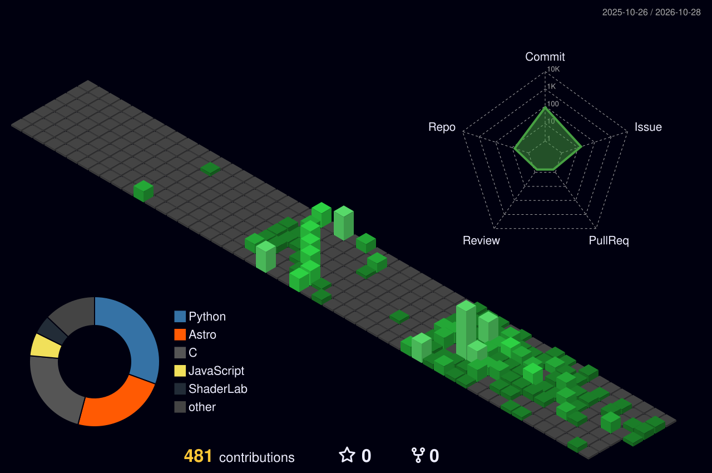

<h1 align="center">Hey, I'm Athrva 👋</h1>

  Computer Science Student · Developer · Builder

  <a href="https://athrvapawar.me">Portfolio</a>
  ·
  <a href="https://github.com/athrvapawar14-arch">GitHub</a>

---

### About Me

- 🎓 CSE student at HITAM, Hyderabad
- 💻 Exploring systems programming, automation, and AI
- 🛠️ Building projects to learn by doing
- 🌱 Currently learning and experimenting with new technologies

### Tech Stack

**Languages**

`C` `Python` `Java` `SQL` `JavaScript`

**Tools & Technologies**

`Git` `Linux` `Docker` `React` `n8n` `MySQL`

### Featured Projects

- **DeskUI / RICE** — JavaFX desktop customization
- **Monitoring & Automation** — Infrastructure monitoring and workflows
- **Neural Networks** — Learning neural networks from the ground up

<!-- Replace these examples with links to your actual repositories. -->

### GitHub Activity

---

  Building, breaking, learning, and building again.

